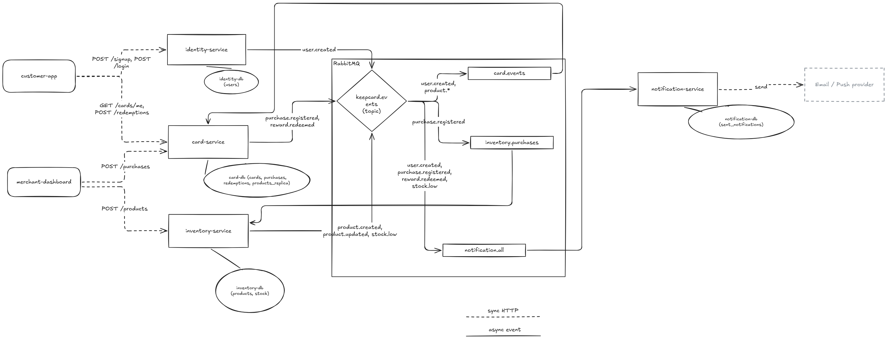

# keep-card — Base Architecture

## Overview

keep-card is a loyalty card platform: customers collect stamps on recurring purchases and redeem rewards once they reach the required amount.

The system follows an **event-driven architecture**. Services own their data and communicate asynchronously through **RabbitMQ**. Synchronous HTTP is used only between clients and services.

> Source file: [`base.excalidraw`](./base.excalidraw). Open it at [excalidraw.com](https://excalidraw.com) to edit.

**Legend:** dashed line = sync HTTP · solid line = async event

## Clients

| Client | Description |
| --- | --- |
| `customer-app` | Used by customers to sign up, log in, check stamps and redeem rewards. |
| `merchant-dashboard` | Used by merchants to register purchases and manage products. |

## Services

### identity-service

Handles user sign-up and authentication (issues JWTs).

- **HTTP:** `POST /signup`, `POST /login`
- **Database:** `identity-db` → `users`
- **Publishes:** `user.created`
- **Consumes:** —

### card-service

Core domain: loyalty cards, purchases (stamps) and reward redemptions. Purchases and redemptions live in the same service so the stamp balance can be checked and updated atomically.

- **HTTP:** `GET /cards/me`, `POST /purchases`, `POST /redemptions`
- **Database:** `card-db` → `cards`, `purchases`, `redemptions`, `products_replica`
- **Publishes:** `purchase.registered`, `reward.redeemed`
- **Consumes:** `user.created` (creates an empty card), `product.*` (keeps `products_replica` up to date)

### inventory-service

Product catalog and stock management.

- **HTTP:** `POST /products`
- **Database:** `inventory-db` → `products`, `stock`
- **Publishes:** `product.created`, `product.updated`, `stock.low`
- **Consumes:** `purchase.registered` (decreases stock)

### notification-service

Sends notifications to customers and merchants through an external Email / Push provider.

- **HTTP:** —
- **Database:** `notification-db` → `sent_notifications`
- **Publishes:** —
- **Consumes:** `user.created`, `purchase.registered`, `reward.redeemed`, `stock.low`

## Messaging

All events go through a single **topic exchange**: `keepcard.events`. Each consumer service has its own queue, so the same event can reach several services.

| Queue | Consumer | Bindings |
| --- | --- | --- |
| `card.events` | `card-service` | `user.created`, `product.*` |
| `inventory.purchases` | `inventory-service` | `purchase.registered` |
| `notification.all` | `notification-service` | `user.created`, `purchase.registered`, `reward.redeemed`, `stock.low` |

**Event naming convention:** `<entity>.<past-tense-verb>`, e.g. `user.created`, `reward.redeemed`.

## Key decisions

- **Database per service:** no service reads another service's database. Data is shared only through events.
- **Read model (`products_replica`):** `card-service` keeps a local copy of only the product fields it needs, fed by `product.*` events. This avoids a synchronous call to `inventory-service` when registering a purchase.
- **Eventual consistency:** a newly created product may take a few milliseconds to show up in `card-service`. This is acceptable for a loyalty card domain.
